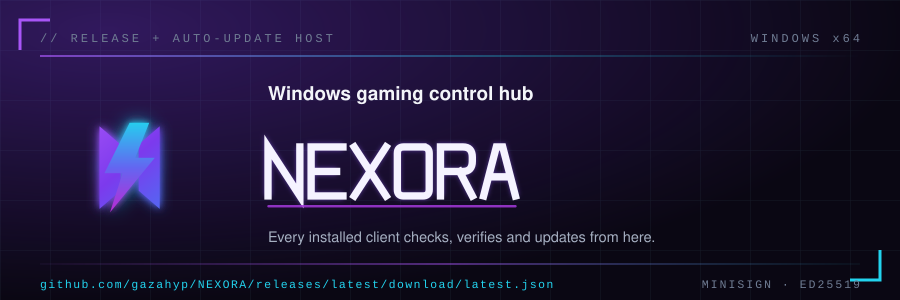
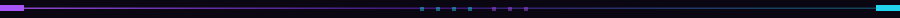
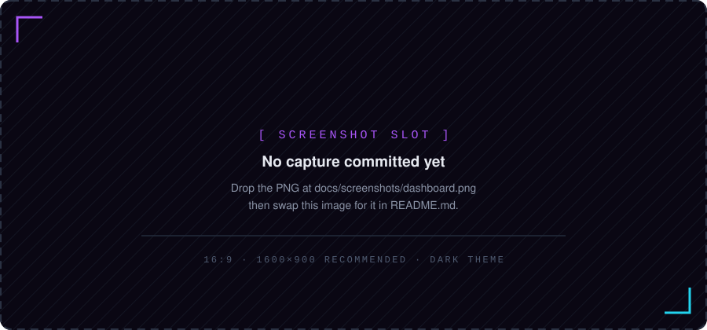

<div align="center">



<br/>

<!-- Live badges: version + download counts follow this repo's releases. -->
<a href="https://github.com/gazahyp/NEXORA/releases/latest"></a>
<a href="https://github.com/gazahyp/NEXORA/releases"></a>
<a href="https://gazahyp.github.io/NEXORA/"></a>

<a href="https://github.com/gazahyp/NEXORA/releases/latest/download/latest.json"></a>


<a href="CONTRIBUTING.md"></a>

</div>



## `NEXORA // WHAT IT IS`

NEXORA is a **native Windows desktop application** — not an Electron wrapper and
not a website. System data, disk scanning, game detection and optimization all
run in the Rust layer through native Windows APIs, streamed to a React UI over
typed Tauri IPC. Free, local-first, with signed auto-updates.

> [!IMPORTANT]
> This repository (`gazahyp/NEXORA`) is the **release and auto-update host**,
> not the application source. It exists so every installed client has exactly
> one trusted place to check for, verify and download new versions.


## `LOADOUT`

| Module | What it does |
|:--|:--|
| **Live system monitor** | CPU, RAM, GPU, VRAM, storage and network, sampled every second with 7-day stored history |
| **Game library** | Auto-detects Steam, Epic, Riot and GOG titles with artwork, playtime tracking and favorites |
| **Smart optimizer** | Scans hardware and software, scores the system, then lists what is worth changing |
| **Game booster** | One click: frees background apps, applies the power plan, launches the game — restores on exit |
| **System cleanup** | Temp files, shader cache, startup apps, disk analyzer |
| **Network tools** | DNS benchmark, stability test, adapter diagnostics |
| **Advanced tweaks** | Safe, reversible HKCU registry tweaks with full undo |
| **Performance trends** | Real CPU/RAM/GPU trends across 1h / 6h / 24h / 7d |
| **Local auth** | Argon2 passwords, email verification, optional Google OAuth (PKCE) — offline-capable |
| **i18n** | English + Bahasa Indonesia with CI-checked dictionary sync |


## `SCREENSHOTS`



<!--
  To publish a real capture:
    1. save the PNG to docs/screenshots/dashboard.png
    2. replace the  above with:
       
  Never leave a mock UI standing in for a screenshot.
-->


## `GET IT`

<div align="center">

<a href="https://gazahyp.github.io/NEXORA/"></a>

</div>

1. Open the [download page](https://gazahyp.github.io/NEXORA/) — it always shows the newest release.
2. Run `NEXORA-Setup-<version>.exe` (NSIS) or unpack the portable `.zip`. An `.msi` is published too.
3. Builds are **not Authenticode-signed** (personal project), so SmartScreen may warn once. Verify
   against `SHA256SUMS.txt` first:

   ```powershell
   Get-FileHash .\NEXORA-Setup-<version>.exe -Algorithm SHA256
   ```

**Updating.** Installed clients update themselves from
[`latest.json`](https://github.com/gazahyp/NEXORA/releases/latest/download/latest.json): the app
downloads the new installer, checks its **minisign (Ed25519)** signature against the public key
embedded in the build, then offers **Install & Restart**. Settings → Update also checks on demand,
and auto-download respects the *Auto update* toggle.


## What is this repository?

`NEXORA` (`gazahyp/NEXORA`) is the **release and auto-update host** for
**NEXORA** — a Windows gaming control hub built with Tauri 2 + Rust + React.
It exists so every installed NEXORA app has exactly one trusted place to
check for, verify, and download new versions.

It contains **no application source code** — only:

| Path | Role |
| --- | --- |
| [`latest.json`](https://github.com/gazahyp/NEXORA/releases/latest/download/latest.json) | Tauri updater manifest served to all installed clients |
| [`index.html`](https://gazahyp.github.io/NEXORA/) | GitHub Pages download landing page |
| [`latest.json`](latest.json) *(in-tree copy)* | Same-origin manifest mirror used by the landing page |
| [Releases](../../releases) | Signed installers, portable archives, checksums |
| [`docs/`](docs/) | Privacy policy, terms, third-party licenses, screenshot slots |
| [`LICENSE`](LICENSE) · [`SECURITY.md`](SECURITY.md) · [`CONTRIBUTING.md`](CONTRIBUTING.md) | Project governance |
| [`brand/`](brand/) | Official NEXORA logo assets (SVG) + README artwork |

> [!IMPORTANT]
> `latest.json` (both copies) and the Releases are **machine-generated** by
> the publish pipeline in the NEXORA source repository — never edit them by
> hand. `README.md`, `index.html`, docs, and brand assets may be maintained
> directly. See [Release pipeline](#release-pipeline).

## Endpoints

```text
Updater manifest (clients poll this)
  https://github.com/gazahyp/NEXORA/releases/latest/download/latest.json

Download landing page (GitHub Pages)
  https://gazahyp.github.io/NEXORA/

Latest release assets
  https://github.com/gazahyp/NEXORA/releases/latest
```

## Supported platforms

| Target key | OS / arch | Artifact |
| --- | --- | --- |
| `windows-x86_64` | Windows 10 / 11 x64 | NSIS setup (`.exe`), portable (`.zip`), MSI |

## Manifest schema

`latest.json` follows the static multi-platform format expected by
[`tauri-plugin-updater`](https://v2.tauri.app/plugin/updater/) v2:

```jsonc
{
  "version": "1.0.30",                  // semver — clients update when this is newer
  "notes": "NEXORA 1.0.30",             // shown in the in-app update dialog
  "pub_date": "2026-09-13T21:59:22.963Z",
  "platforms": {
    "windows-x86_64": {
      "url": "https://github.com/gazahyp/NEXORA/releases/download/v1.0.30/NEXORA-Setup-1.0.30.exe",
      "signature": "dW50cnVzdGVk..."   // base64 minisign signature of the .exe bytes
    }
  }
}
```

## Release pipeline

Every publish runs through `scripts/publish-update.mjs` in the NEXORA repo,
which is **atomic and self-verifying**:

```text
npm run release            npm run publish:update
─────────────────         ─────────────────────────────────────────
Tauri build (NSIS+MSI) →  1. locate signed bundle (installer + .sig)
minisign signature        2. build latest.json
                          3. VERIFY signature against the exact bytes
                             (Ed25519 over BLAKE2b-512, same scheme as
                              the client) — abort on mismatch
                          4. upload NEXORA-Setup-<v>.exe + latest.json
                             as GitHub Release v<v>, marked "latest"
                          5. sync the Pages latest.json mirror
```

Guarantees:

- **Idempotent** — republishing the same version deletes and recreates the
  tag, so a retried release can never leave duplicates or drift.
- **Fail-closed** — a build whose signature does not verify against the
  configured pubkey is never uploaded; installed apps can not be poisoned by
  a broken publish.
- **Version-pinned assets** — every release carries its own copy of the
  installer (`NEXORA-Setup-<version>.exe`), so old clients can always fetch
  the exact bytes their manifest points to.

## Security model

- Installers are signed with a **minisign (Ed25519) key**; the public key
  ships embedded in every NEXORA build (`plugins.updater.pubkey`).
- The updater **rejects any manifest entry whose signature does not match**
  the downloaded artifact — artifacts served from this repo can not be
  swapped or tampered with in transit.
- Release bodies include **SHA-256 checksums** for manual verification:
  `Get-FileHash .\NEXORA-Setup-<version>.exe -Algorithm SHA256`
- Builds are not Authenticode-signed (personal project). First run may show
  a SmartScreen “Unknown publisher” warning; the checksum above confirms the
  file is the one published here.

## Manual operations

Only needed when the automated pipeline misbehaves:

```bash
# Promote an existing release to "latest" (what /releases/latest/ resolves to)
gh release edit v1.0.30 --latest -R gazahyp/NEXORA

# Re-point the Pages mirror at a specific release's manifest
gh release download v1.0.30 -p latest.json -D . -R gazahyp/NEXORA --clobber
git commit -am "chore(pages): point latest.json at v1.0.30" && git push

# Remove a bad release (prevents clients from resolving it)
gh release delete v1.0.30 --yes -R gazahyp/NEXORA
```

## Documentation

| Document | About |
| --- | --- |
| [Privacy Policy](docs/privacy-policy.md) | What NEXORA stores locally vs. transmits — it's local-first, and the list is short |
| [Terms of Service](docs/terms-of-service.md) | Usage rules: official game sources only, reversible system tweaks |
| [Third-party licenses](docs/third-party-licenses.md) | Attribution for every runtime dependency |
| [Security Policy](SECURITY.md) | How to report vulnerabilities + the app's security design |
| [Contributing](CONTRIBUTING.md) | Bug reports, feedback, docs & translations |
| [Code of Conduct](CODE_OF_CONDUCT.md) | The community part |

## License

NEXORA is **freeware, not open source** — free to use and to redistribute
via unmodified installers from [GitHub Releases](../../releases), with all
other rights reserved. Full terms: [LICENSE](LICENSE).

Third-party components remain under their own licenses
([attribution](docs/third-party-licenses.md)); game data and cover artwork
belong to their respective publishers.

---

<div align="center">

<sub>Made with &#9749; by <a href="https://github.com/gazahyp">Gaza Ibrahim</a> — <a href="https://gazahyp.github.io/NEXORA/">download NEXORA</a></sub>

<sub><i>if it isn't shipped, it isn't done.</i></sub>

</div>
